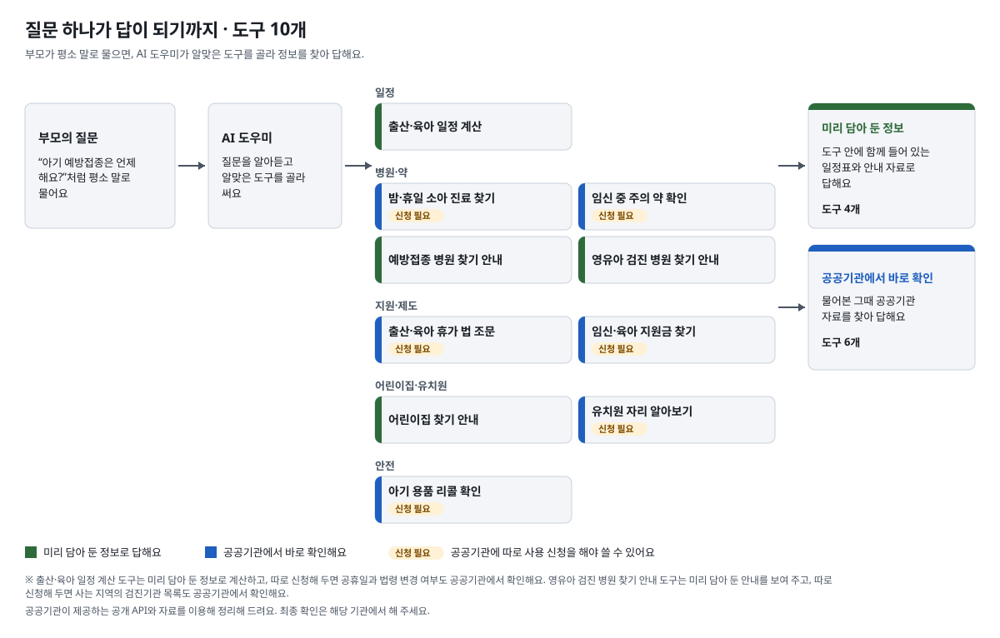
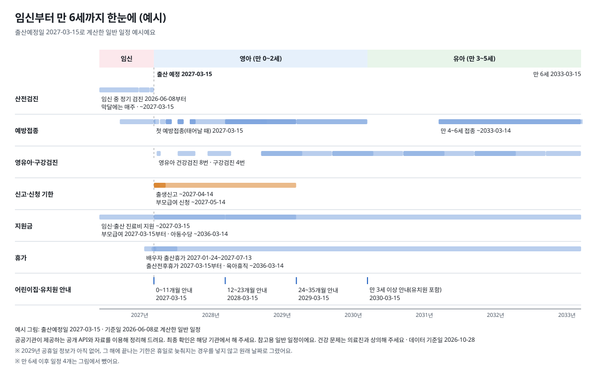
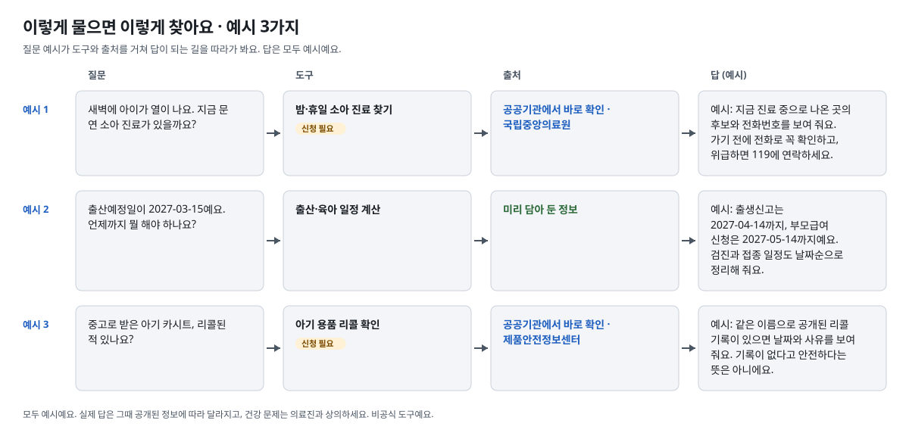
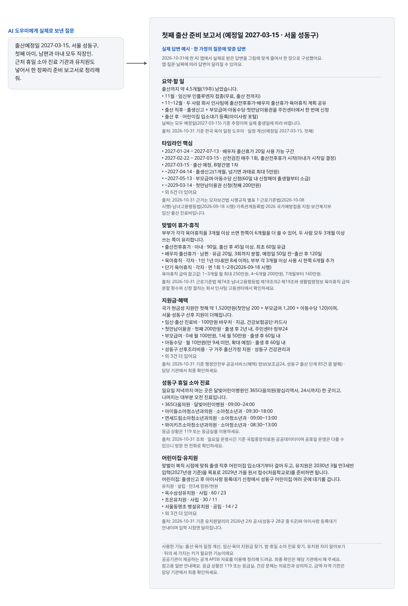

# korean-parenting-mcp

**한국 임신·출산·육아 정보 MCP 서버**

출산 예정일이나 아이 생일만 알려 주면 예방접종·건강검진·휴가·신청 기한 같은 일정을 날짜 순서대로 정리해 줘요. 이 일정 안내가 핵심 기능이고, API 키 없이 설치하자마자 쓸 수 있어요. MCP를 지원하는 AI 도우미에 연결해 두고 평소처럼 물어보면 돼요.

[브라우저에서 체험해 보기](https://ok0.github.io/korean-parenting-mcp/): 출산예정일을 넣으면 맞춤 일정 예시를 이 브라우저 안에서 계산해 보여 줍니다. 설치가 필요 없고, 입력값은 어디에도 전송·저장되지 않습니다.

## 바로가기

처음이라면 → [처음이라면: 쉬운 시작 안내](https://github.com/ok0/korean-parenting-mcp/blob/main/docs/start.md)

- [처음이라면: 쉬운 시작 안내](https://github.com/ok0/korean-parenting-mcp/blob/main/docs/start.md) — 무엇을 하는 도구인지, 어떻게 설치하는지 차근차근 알려 드려요
- [키 없이 바로 쓰는 기능](https://github.com/ok0/korean-parenting-mcp/blob/main/docs/keyless.md) — 출산 예정일이나 아이 생일만 말하면 접종·검진·휴가 일정을 정리해 줘요
- [설치 방법 고르기](https://github.com/ok0/korean-parenting-mcp/blob/main/docs/install.md) — 내 상황에 맞는 설치 방법 하나만 골라요
  - [Claude 데스크톱 앱에 설치하기(파일 하나로)](https://github.com/ok0/korean-parenting-mcp/blob/main/docs/mcpb.md) — 터미널 없이 파일 하나를 내려받아 열면 돼요
    - [설치 파일 바로 내려받기](https://github.com/ok0/korean-parenting-mcp/releases/download/mcpb-latest/korean-parenting-mcp.mcpb)
  - [설정 마법사로 설치하기](https://github.com/ok0/korean-parenting-mcp/blob/main/docs/setup-wizard.md) — 명령 한 줄로 키 입력과 앱 등록을 한 번에 해요
  - [직접 설정하기(AI 앱별)](https://github.com/ok0/korean-parenting-mcp/blob/main/docs/clients/README.md) — 쓰는 AI 앱의 설정에 서버를 직접 추가해요
    - [VS Code](https://github.com/ok0/korean-parenting-mcp/blob/main/docs/clients/vscode.md) — VS Code 설정 파일에 서버를 추가해요
    - [Cursor](https://github.com/ok0/korean-parenting-mcp/blob/main/docs/clients/cursor.md) — Cursor 설정 파일에 서버를 추가해요
    - [Gemini CLI·Gemini Code Assist](https://github.com/ok0/korean-parenting-mcp/blob/main/docs/clients/gemini.md) — 두 앱이 함께 쓰는 설정 파일에 서버를 추가해요
    - [Antigravity](https://github.com/ok0/korean-parenting-mcp/blob/main/docs/clients/antigravity.md) — Antigravity 설정 파일에 서버를 추가해요
    - [Codex](https://github.com/ok0/korean-parenting-mcp/blob/main/docs/clients/codex.md) — Codex 설정 파일(TOML)에 서버를 추가해요
    - [Claude 데스크톱 앱](https://github.com/ok0/korean-parenting-mcp/blob/main/docs/clients/claude-desktop.md) — 설정 파일을 직접 고쳐서 서버를 추가해요
    - [Claude Code](https://github.com/ok0/korean-parenting-mcp/blob/main/docs/clients/claude-code.md) — 명령 한 줄로 서버를 등록해요
    - [그 밖의 AI 앱](https://github.com/ok0/korean-parenting-mcp/blob/main/docs/clients/others.md) — 다른 AI 앱 설정 방법을 모아 둔 안내예요(아직 직접 확인하지 못했어요)
- [API 키로 기능 더하기(선택)](https://github.com/ok0/korean-parenting-mcp/blob/main/docs/advanced.md) — 야간 진료기관·리콜 조회처럼 키가 필요한 기능과 키 발급 방법

공공기관이 제공하는 공개 API와 자료를 이용해 정리해 드려요. 최종 확인은 해당 기관에서 해 주세요.

의료 정보는 진료를 대체하지 않으니 건강 상태나 치료는 반드시 의료진과 상담하세요. 법률·제도 정보는 법률 자문이 아니므로 적용 여부, 신청 방법, 기한은 관할 기관에 확인하세요.

## 그림으로 보기

MCP를 지원하는 AI 도우미에 연결하면, AI 도우미가 질문에 맞는 도구를 골라 답을 만듭니다. 아래 그림은 예시이며 실제 답은 질문과 날짜에 따라 달라집니다.

<picture>
  <source media="(prefers-color-scheme: dark)" srcset="https://raw.githubusercontent.com/ok0/korean-parenting-mcp/main/assets/tool-map-dark.svg">
  
</picture>

<picture>
  <source media="(prefers-color-scheme: dark)" srcset="https://raw.githubusercontent.com/ok0/korean-parenting-mcp/main/assets/life-timeline-dark.svg">
  
</picture>

<picture>
  <source media="(prefers-color-scheme: dark)" srcset="https://raw.githubusercontent.com/ok0/korean-parenting-mcp/main/assets/question-stories-dark.svg">
  
</picture>

<picture>
  <source media="(prefers-color-scheme: dark)" srcset="https://raw.githubusercontent.com/ok0/korean-parenting-mcp/main/assets/report-example-dark.svg">
  
</picture>

## 라이선스

MIT — `LICENSE` 참조
